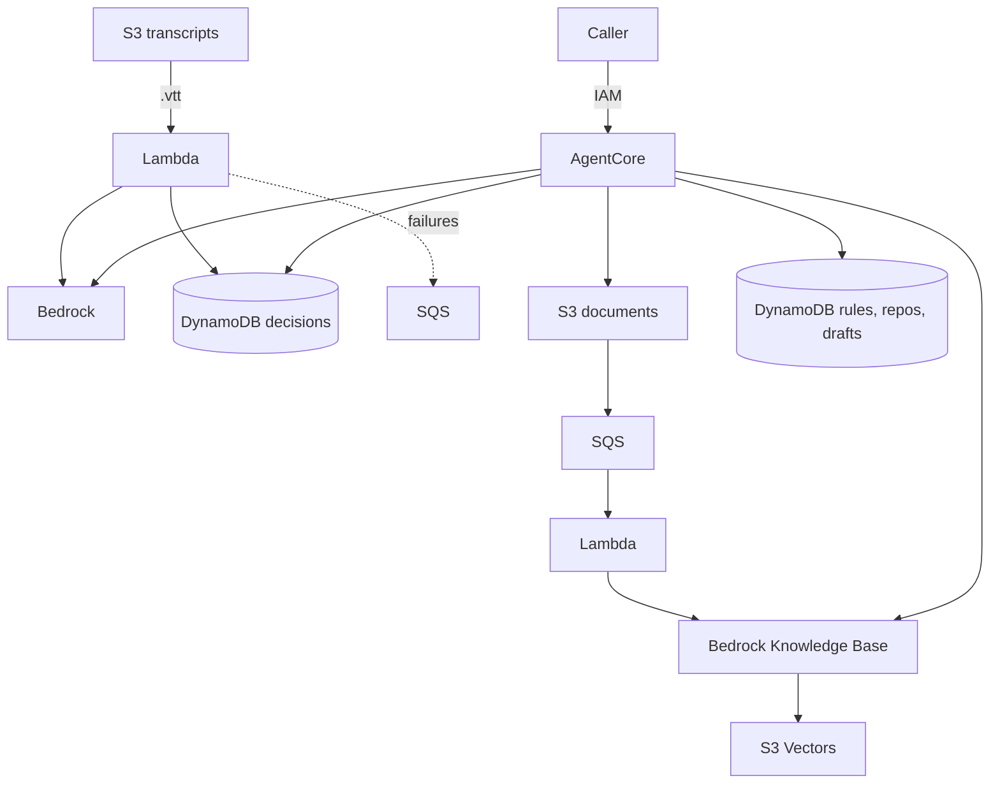

# Minivela

Minivela is the open-source, self-hosted baby brother of [Supervela](https://www.supervela.com). It keeps project memory and drafts a one-shot work-order prompt from a Jira ticket and the knowledge base: meeting decisions, notes, and handbooks.

## Components



## Provision

Deploy the CDK stack into your own AWS account. You pay the Bedrock tokens. There is no subscription and no console.

```bash
npx cdk deploy --profile my-profile --region us-east-1
```

The region must be `us-east-1`, `us-east-2`, or `us-west-2`. The stack name defaults to `minivela`.

Uploading transcripts, dropping documents, and invoking the agent are in the [how-to](docs/how-to.md).

## License

[MIT](LICENSE)
